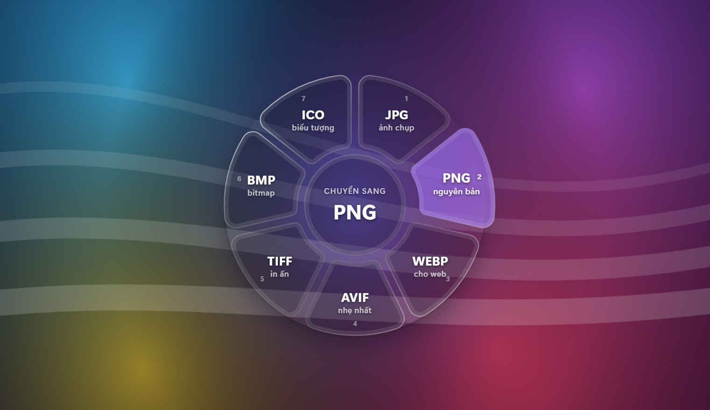
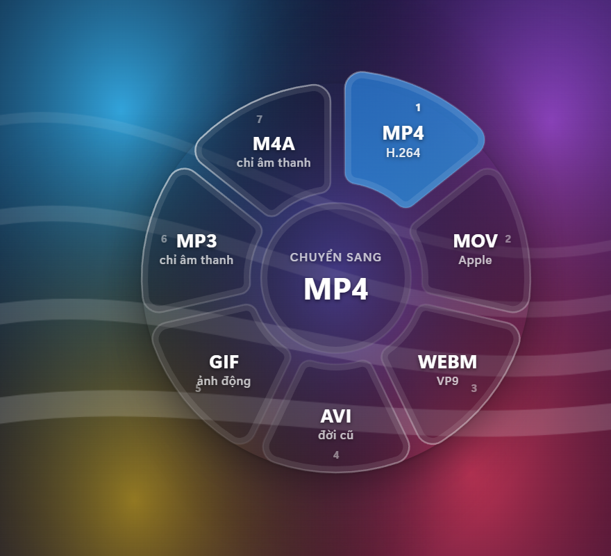
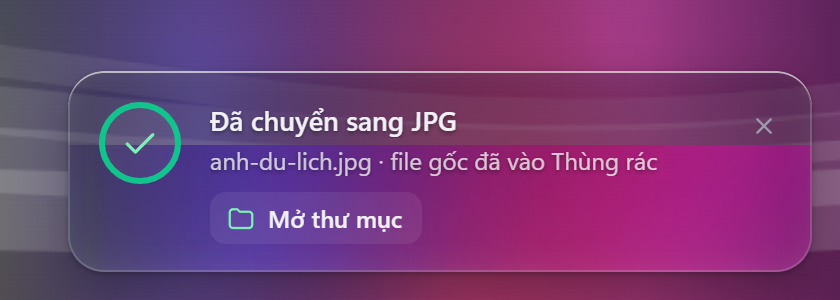
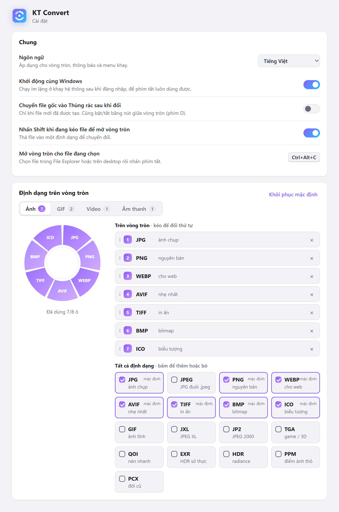

<div align="center">


# KT Convert

**Đổi định dạng file ngay trong File Explorer — không mở app, không upload.**<br />
Chọn file → <kbd>Ctrl</kbd> + <kbd>Alt</kbd> + <kbd>C</kbd> → bấm định dạng. Xong.

[](https://github.com/trakhanh/KTConvertAIO/releases/latest) [](https://github.com/trakhanh/KTConvertAIO/releases)   

<a href="https://github.com/trakhanh/KTConvertAIO/releases/latest/download/KTConvert-0.1.3-Setup.exe">
  
</a>

<sub>[Tất cả phiên bản](https://github.com/trakhanh/KTConvertAIO/releases) · Tác giả: <b>Khánh Trà</b></sub>

<br /><br />



</div>

<br />

## ✨ Điểm nổi bật

<table>
  <tr>
    <td width="33%" valign="top">
      <h3>⚡ Không cần mở app</h3>
      Chọn file trong Explorer rồi nhấn phím tắt, hoặc nhấn <kbd>Shift</kbd> khi đang kéo file. Vòng tròn hiện ngay dưới con trỏ.
    </td>
    <td width="33%" valign="top">
      <h3>🔒 Offline 100%</h3>
      Mọi chuyển đổi chạy trên máy bạn bằng FFmpeg đi kèm. File không bao giờ bị gửi lên mạng.
    </td>
    <td width="33%" valign="top">
      <h3>🎨 Liquid glass</h3>
      Giao diện kính mờ khúc xạ hình nền phía sau, hiệu ứng mượt, tự co vào trong khi gần mép màn hình.
    </td>
  </tr>
  <tr>
    <td valign="top">
      <h3>🧩 Hơn 50 định dạng</h3>
      Ảnh, GIF, video, âm thanh: JPG, PNG, WEBP, AVIF, HEVC, ProRes, MP3, FLAC… Tự chọn 8 định dạng hay dùng.
    </td>
    <td valign="top">
      <h3>🗑️ Giữ hoặc xoá file gốc</h3>
      Một nút ngay giữa vòng tròn. Xoá là chuyển vào Thùng rác — luôn lấy lại được.
    </td>
    <td valign="top">
      <h3>🇻🇳 Tiếng Việt</h3>
      Giao diện, thông báo và trình cài đặt có tiếng Việt và tiếng Anh. Tự khởi động cùng Windows.
    </td>
  </tr>
</table>

## 🚀 Dùng trong 3 bước

| 1. Chọn file | 2. Mở vòng tròn | 3. Bấm định dạng |
| :---: | :---: | :---: |
| Một hoặc nhiều file trong File Explorer hoặc trên desktop | Nhấn <kbd>Ctrl</kbd>+<kbd>Alt</kbd>+<kbd>C</kbd> — hoặc nhấn <kbd>Shift</kbd> khi đang kéo file | Bấm chuột, phím số <kbd>1</kbd>–<kbd>8</kbd>, hoặc thả file vào ô. File mới nằm ngay cạnh file gốc |

<table>
  <tr>
    <td width="50%" align="center" valign="top">
      <br />
      <sub>Mỗi loại file có bộ định dạng riêng — đây là video</sub>
    </td>
    <td width="50%" align="center" valign="top">
      <br />
      <sub>Thông báo tiến độ ở góc màn hình, bấm để mở thư mục</sub>
    </td>
  </tr>
</table>

## 📥 Cài đặt

1. Bấm nút **Tải KT Convert** ở trên (hoặc vào [Releases](https://github.com/trakhanh/KTConvertAIO/releases/latest)) để tải `KTConvert-0.1.3-Setup.exe`.
2. Mở file vừa tải, chọn ngôn ngữ và bấm cài. **Không cần quyền admin**, FFmpeg đã có sẵn trong bộ cài.
3. Xong! Biểu tượng KT Convert nằm ở khay hệ thống (góc phải dưới, có thể ẩn trong mũi tên **^**) và sẽ tự chạy mỗi khi bật máy.

> [!NOTE]
> Windows có thể hiện **"Windows protected your PC"** vì app chưa có chữ ký số. Bấm **More info → Run anyway** để cài.

## ⚙️ Tuỳ chỉnh

Bấm biểu tượng ở khay → **Cài đặt…**



- **Ngôn ngữ:** Theo Windows / Tiếng Việt / English
- **Khởi động cùng Windows** (mặc định bật)
- **Chuyển file gốc vào Thùng rác** sau khi đổi — cũng bật/tắt bằng nút giữa vòng tròn hoặc phím <kbd>D</kbd>
- **Shift khi kéo file** để mở vòng tròn
- **Định dạng trên vòng tròn:** với mỗi loại file, chọn tối đa 8 định dạng và kéo để sắp xếp thứ tự; xem trước vòng tròn ngay bên cạnh

<br clear="right" />

## 🎞️ Định dạng hỗ trợ

<sub>In đậm là định dạng có sẵn trên vòng tròn; còn lại bật trong Cài đặt.</sub>

| Loại file | Đổi sang |
| --- | --- |
| 🖼️ **Ảnh**<br /><sub>jpg, png, webp, heic, avif, bmp, tiff, ico, jxl, exr, psd…</sub> | **JPG · PNG · WEBP · AVIF · TIFF · BMP · ICO** · JPEG · GIF · JXL · JP2 · TGA · QOI · EXR · HDR · PPM · PCX |
| 🎞️ **GIF** | **MP4 · WEBM · MOV · WEBP động · PNG · JPG** · MKV · APNG |
| 🎬 **Video**<br /><sub>mp4, mov, mkv, webm, avi, wmv, flv, ts…</sub> | **MP4 · MOV · MKV · WEBM · AVI · GIF · MP3 · M4A** · HEVC (H.265) · WMV · FLV · TS · MPG · OGV · ProRes · WAV · FLAC · OPUS |
| 🎵 **Âm thanh**<br /><sub>mp3, m4a, wav, flac, ogg, opus, aiff, wma…</sub> | **MP3 · M4A · WAV · FLAC · OGG · OPUS · AIFF · WMA** · AAC · AC3 · ALAC · M4R (nhạc chuông iPhone) · MKA |

## ❓ Câu hỏi thường gặp

<details>
<summary><b>Nhấn Ctrl+Alt+C mà không thấy gì?</b></summary>
<br />
Hãy chọn file trong File Explorer hoặc trên desktop trước khi nhấn. Nếu app khác đã chiếm phím tắt này, KT Convert sẽ báo ngay khi khởi động. Kiểm tra biểu tượng KT Convert có ở khay hệ thống không.
</details>

<details>
<summary><b>File có bị gửi lên mạng không?</b></summary>
<br />
Không. Mọi chuyển đổi chạy offline trên máy bằng FFmpeg đi kèm bộ cài.
</details>

<details>
<summary><b>File mới được lưu ở đâu? File gốc thì sao?</b></summary>
<br />
Ngay cạnh file gốc: <code>anh.png</code> → <code>anh.jpg</code> (trùng tên thì thành <code>anh (1).jpg</code>). Mặc định file gốc được giữ nguyên; nếu bật xoá, file gốc vào Thùng rác chứ không mất hẳn.
</details>

<details>
<summary><b>Làm sao tắt tự khởi động hoặc gỡ app?</b></summary>
<br />
Tắt trong <b>Cài đặt → Khởi động cùng Windows</b>. Gỡ app: <b>Settings → Apps → Installed apps → KT Convert → Uninstall</b> (mục tự khởi động cũng được xoá theo).
</details>

<details>
<summary><b>Vì sao Windows cảnh báo khi cài?</b></summary>
<br />
App chưa được ký số (code signing). Bộ cài chỉ chứa KT Convert và FFmpeg; toàn bộ mã nguồn nằm trong repo này.
</details>

## 🛠️ Dành cho lập trình viên

<details>
<summary>Build từ mã nguồn, chạy test, cấu trúc thư mục</summary>
<br />

Viết bằng [Tauri 2](https://tauri.app) (Rust) + TypeScript, không dùng framework giao diện.

**Cần:** Rust (MSVC), Node 20+, Visual Studio Build Tools (C++) + Windows SDK, và `ffmpeg.exe` trên PATH.

```bash
npm install
npm run tauri dev
```

Xem giao diện trên trình duyệt (chế độ demo, không cần Rust): `npm run dev`, rồi mở `http://localhost:1420/wheel.html?lang=vi`, `/settings.html?lang=vi` hoặc `/toast.html?lang=vi`.

Test chuyển đổi mọi định dạng trên file mẫu trong `samples/`:

```bash
cd src-tauri
cargo test --lib -- --nocapture
```

**Build bộ cài:** đặt `ffmpeg.exe` vào `src-tauri/ffmpeg/` (không đưa lên git vì ~217 MB), rồi chạy `npm run tauri build`. Kết quả ở `src-tauri/target/release/bundle/nsis/`.

| File | Vai trò |
| --- | --- |
| `src-tauri/src/lib.rs` | Khởi động, khay hệ thống, phím tắt, lệnh cho giao diện |
| `src-tauri/src/explorer.rs` | Đọc file đang chọn trong Explorer/desktop qua Shell COM (hỗ trợ tab Windows 11) |
| `src-tauri/src/dragwatch.rs` | Phát hiện "Shift khi đang kéo file" |
| `src-tauri/src/formats.rs` | Danh mục định dạng, tham số FFmpeg |
| `src-tauri/src/convert.rs` | Hàng đợi chuyển đổi, gọi FFmpeg, tiến độ |
| `src-tauri/src/backdrop.rs` | Chụp nền phía sau cửa sổ cho hiệu ứng kính |
| `src-tauri/src/i18n.rs`, `src/i18n.ts` | Chuỗi tiếng Việt / tiếng Anh |
| `src/wheel.*`, `src/toast.*`, `src/settings.*` | Vòng tròn, thông báo, cửa sổ Cài đặt |
| `src/glass-core.ts`, `src/glass.worker.ts` | Dựng lớp kính trong Web Worker |

</details>

## 📄 Giấy phép bên thứ ba

Bộ cài kèm [FFmpeg](https://ffmpeg.org) (bản full build của [gyan.dev](https://www.gyan.dev/ffmpeg/builds/)) theo giấy phép **GPL v3** — xem [`src-tauri/ffmpeg/FFMPEG-LICENSE.txt`](src-tauri/ffmpeg/FFMPEG-LICENSE.txt).

<br />

<div align="center">
  <sub>Làm với ❤️ bởi <b>Khánh Trà</b> · Lấy cảm hứng từ Tangerine trên macOS</sub>
</div>
